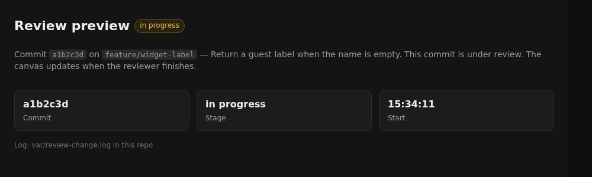
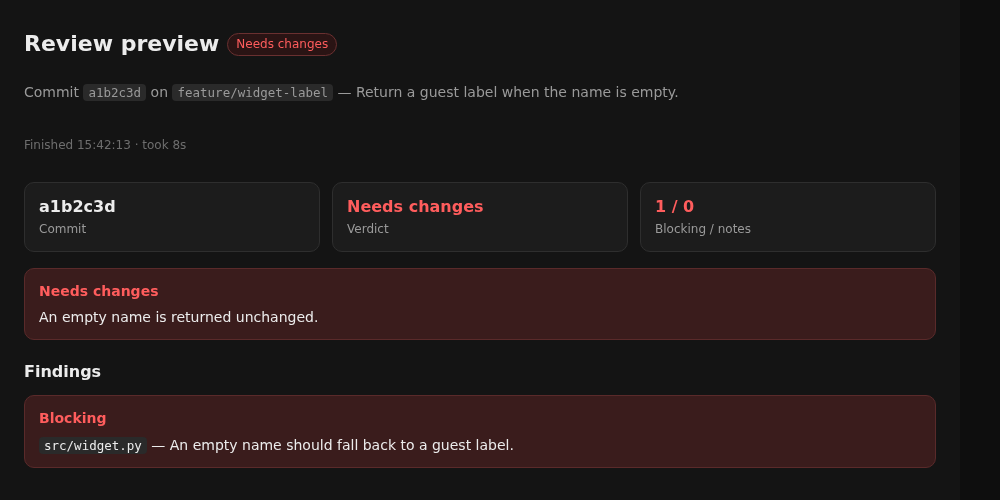
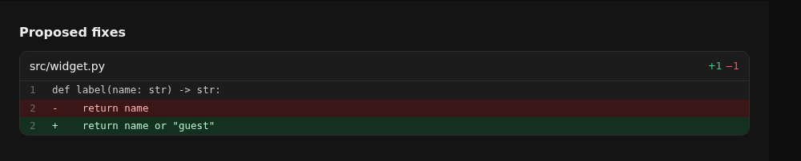
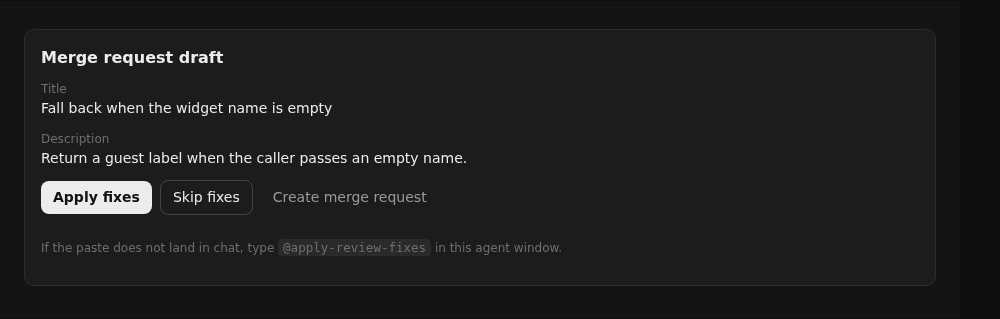

# merge-reviewer

A Cursor post-commit reviewer that works the same way in any git project. The engine lives here. A project keeps no copy of it: `install/link-project.sh` symlinks the skills, agent, commands, and extension, and the git hook calls `bin/post-commit-review`.

The canvas renders only inside Cursor. Claude Code does not render it. Nothing is pushed until a person clicks **Create merge request**.

## How it works

1. You commit on a laptop. The git hook (installed by the project template from `install/post-commit.sh`) starts `bin/post-commit-review` and returns immediately, so git is never blocked.
2. The engine reads `.agent-tools/config.md`. If that file is missing it uses the old keys in `PROJECT.md` and logs one migration line. Opt out on this laptop with `- **Merge reviewer:** off` in `<git-dir>/agent-tools.local`. Skip markers are `REVIEW_CHANGE=0`, `REVIEW_CHANGE_SKIP=1`, `[skip review]` in the subject, the default branch, a merge commit, and an in-progress rebase or merge.
3. Optional unit tests. When **Pre-review command** is set, that command runs first. Its summary is shown on the canvas. A failure is logged and does not fail the commit. `REVIEW_CHANGE_PHPUNIT=0` skips the command.
4. One model analysis. The script matches the diff against `docs/features/INDEX.md` (when that file exists) and inlines only the matching rows plus `docs/notes/<slug>.md` and `docs/notes/_general.md`. When **Agent layer** is `committed`, it also inlines a local-tool block so a tracked file replaced by a symlink is not judged lost. The model writes one JSON file, `var/review-change.analysis.json`. There is no shard split and no second model.
5. The script renders the canvas from that JSON. If rendering throws, one model fallback may write the canvas. The fallback does not re-review the diff.
6. Buttons on the canvas open trigger files. The `review-apply` extension pastes **Apply fixes** or **Skip fixes** into the current chat, or opens a terminal that pushes and opens the host's new-merge-request page.

Default scope is the triggering commit (`HEAD~1...HEAD`). `REVIEW_CHANGE_SCOPE=branch` reviews the whole branch against the base. A file is remembered by git blob, so an unchanged file is not reviewed again. Skip stores the finding anchors on the branch so they are not raised again.

## Screenshots

English demo from `examples/demo` (`src/widget.py`). The finding, the proposed diff, and **Apply fixes** are the same blocks the canvas renders. Shop reviews stay on the laptop; these pictures do not use a real repository.



The canvas while the analysis is still running.



Verdict and the blocking note after the script renders the JSON.



The proposed replacement for `return name`.



Apply fixes, Skip fixes, and Create merge request.

Regenerate the live canvas with `bin/post-commit-review --demo` from `examples/demo`, then open the printed canvas in Cursor. The component paints only inside Cursor.

## Install

1. Clone this repository.
2. `bash install/install-runtime.sh`  
   Installs the agent CLI, `pip install --user cursor-sdk`, the review-apply extension, and asks for the `crsr_` dashboard key. The key is stored in `~/.config/review-change/cursor.env` (mode 600). The script also writes `MERGE_REVIEWER_HOME` there. It never prints the key.
3. Link a project with the project-template installer, or directly:

   ```bash
   bash install/link-project.sh /path/to/project
   ```

   The project's git hook is `install/post-commit.sh`, copied by the project template. It resolves `MERGE_REVIEWER_HOME`, then `$(dirname "$CURSOR_TEMPLATE_HOME")/merge-reviewer`, then `<project>/tools/merge-reviewer`. If none of those exist it prints one line and exits 0.
4. Reload the Cursor window.

`install/link-project.sh /path/to/project --check` prints `ok`, `missing`, or `conflict` for each link, then `opted_out: yes` or `opted_out: no`. `--unlink` removes only links that point into this repository, the managed exclude block, and trigger files whose first line is `canvas-trigger`.

## Configuration

Tool settings are bullets in `.agent-tools/config.md`. Project blocking rules stay in `PROJECT.md` under `## Quality bar`. See [docs/configuration.md](docs/configuration.md) for every key, its default, and the environment variables. The contract a project must satisfy is [docs/project-contract.md](docs/project-contract.md).

## Limits

- Cursor only for the canvas. Other agents can still run the apply and skip commands.
- One analysis per commit. Large diffs stay one pass unless `REVIEW_CHANGE_MAX_DIFF_KB` is set.
- The hook never fails git. Tests that fail are reported on the canvas and in `var/review-change.log`.
- Create merge request is the only push, and only after the click. It uses the host URL from **Git host** / **Git project**, or from `origin` when those are empty (GitHub, GitLab-style, Bitbucket).
